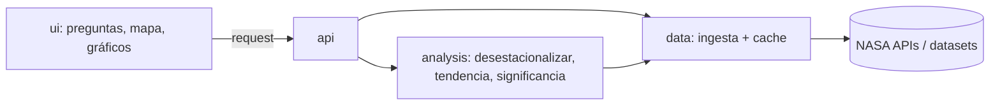
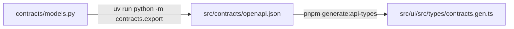

# Arquitectura

> Fuente de verdad de los contratos: modelos Pydantic en `src/contracts/`, exportados a OpenAPI y a tipos TS (ver [Contratos](#contratos)).

## Componentes

| Área | Responsabilidad | Carpeta |
|---|---|---|
| data | Descargar/subconjuntar variables por región y periodo; cache | `src/data/` |
| analysis | Agregación, remoción estacional, tendencia, significancia | `src/analysis/` |
| api | Exponer catálogo y resultados | `src/api/` |
| ui | Flujo guiado, mapa, gráficos, demos | `src/ui/` |

## Contratos

Fuente de verdad: modelos Pydantic en [`src/contracts/contracts/models.py`](../src/contracts/contracts/models.py) (paquete `contracts`, miembro del workspace de uv).

CI falla si `openapi.json` o `contracts.gen.ts` no coinciden con los modelos.

| Modelo | Productor → consumidor | Contenido |
|---|---|---|
| `Variable`, `CatalogResponse` | data → api → ui | Catálogo: unidades, definición simple, paleta, fuente, periodo |
| `BBox` | ui → api → data | `min_lon, min_lat, max_lon, max_lat` |
| `TimeSeries` | data → analysis | Serie mensual promediada por área (`YYYY-MM`, `null` = sin dato) |
| `TrendResult` | analysis → api → ui | Pendiente/década, IC 95 %, p-valor, α, dirección, cambio total, n, periodo |
| `AnalysisResponse` | analysis → api → ui | Serie, anomalías, línea de tendencia, `TrendResult`, veredicto en texto |
| `TrendRequest` | ui → api | Variable, bbox, periodo |
| `ErrorResponse` | api → ui | `{error: {code, message}}` |
| `DemoManifest`, `Demo`, `DemoPanel` | pipeline → ui (estático) | Demos precalculadas en `src/ui/public/demos/` |
| `TrendMapManifest`, `TrendMapEntry`, `TrendCellProperties` | pipeline → ui (estático) | Mapas de tendencia en `src/ui/public/trend-maps/` |

## API

| Método | Ruta | Respuesta |
|---|---|---|
| GET | `/health` | `{"status": "ok"}` |
| GET | `/variables` | `CatalogResponse` |
| POST | `/trend` | `TrendRequest` → `AnalysisResponse` (errores: `ErrorResponse`) |

## Stack

Decidido en [`decisions/2026-11-14-stack.md`](decisions/2026-11-14-stack.md):

- **Frontend**: React + Vite + TypeScript · MapLibre GL · Plotly · pnpm · eslint + vitest · Vercel
- **Backend**: Python 3.12 + FastAPI en Docker · NASA POWER (endpoint `regional`, promedio por área en `data`) · pymannkendall + scipy · uv · ruff + pytest · Render (gratis)
- **Precalculado**: pipeline Python en `src/pipeline/` → demos y mapas de tendencia como archivos estáticos en `src/ui/public/`
- **Contratos**: Pydantic (`src/contracts/`) → OpenAPI → tipos TS (`openapi-typescript`)
- **Sin base de datos**: caché temporal en el backend
