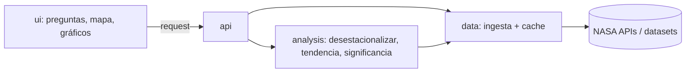

# Arquitectura

> Estado: **borrador**. Stack pendiente de ADR en `decisions/`. Los contratos se migrarán a esquemas en `src/contracts/`.

## Componentes



| Área | Responsabilidad | Carpeta |
|---|---|---|
| data | Descargar/subconjuntar variables por región y periodo; cache | `src/data/` |
| analysis | Agregación, remoción estacional, tendencia, significancia | `src/analysis/` |
| api | Exponer catálogo y resultados | `src/api/` |
| ui | Flujo guiado, mapa, gráficos, demos | `src/ui/` |

## Contratos

### Serie temporal (data → analysis)

```json
{
  "variable": "string (id del catálogo)",
  "units": "string",
  "region": { "type": "bbox", "coords": [minLon, minLat, maxLon, maxLat] },
  "resolution": "daily | monthly",
  "time": ["ISO-8601"],
  "values": [number | null],
  "source": "id en data-sources.md"
}
```

### Resultado de tendencia (analysis → api/ui)

```json
{
  "method": "mann-kendall+sen | ols",
  "deseasonalized": true,
  "slope": number,
  "slope_units": "units/decade",
  "p_value": number,
  "significant": boolean,
  "alpha": 0.05,
  "ci": [low, high],
  "n": integer,
  "period": ["ISO-8601", "ISO-8601"]
}
```

## Stack

_Pendiente de decisión._ Ver `decisions/`.
