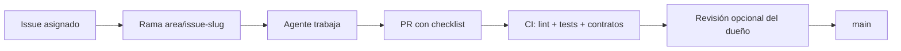

# Colaboración

Varias personas, cada una con sus propios agentes. Este doc define cómo trabajar sin pisarse. Las reglas operativas para agentes están resumidas en [`AGENTS.md`](../AGENTS.md).

## Principios

1. **El estado vive en GitHub, no en archivos.** Tareas = Issues; tablero = GitHub Projects.
2. **Aislamiento**: una rama y un PR por issue. Nadie hace push directo a `main`.
3. **Áreas con dueño humano**: `CODEOWNERS` asigna al dueño como revisor sugerido; la revisión es opcional y no bloquea el merge.
4. **Contratos en código, verificados por CI**: no basta con documentarlos.

## Flujo

1. Toma o crea un issue con etiqueta de área (`area:data`, `area:analysis`, `area:api`, `area:ui`, `area:docs`) y asígnatelo.
2. Rama: `<area>/<n-issue>-<slug>` (ej. `data/12-nasa-power-client`).
3. El PR enlaza el issue (`Closes #12`) y cumple el checklist de la plantilla.
4. Merge: el autor puede hacer merge sin aprobación. Pide revisión si el cambio afecta a otra área.

## Áreas y dueños

| Área | Carpeta | Doc | Dueño |
|---|---|---|---|
| data | `src/data/` | `data-sources.md` | @Alanzphy |
| analysis | `src/analysis/` | `science.md` | @Alanzphy |
| api | `src/api/` | `architecture.md` | @Alanzphy |
| ui | `src/ui/` | `product.md`, `glossary.md` | @Alanzphy |
| contracts | `src/contracts/` | `architecture.md` | @Alanzphy |

Cada área tiene su propio `AGENTS.md` con las reglas específicas del área.

## Contratos

- Definidos como esquemas en `src/contracts/` (formato pendiente del ADR de stack); `architecture.md` los describe y enlaza.
- Cambiar un contrato requiere un PR propio con su ADR; avisa a los dueños de las áreas afectadas antes de hacer merge.
- CI valida que productores y consumidores cumplen el esquema.

## Decisiones (ADRs)

- Archivo: `docs/decisions/YYYY-MM-DD-slug.md`. Con fecha en el nombre, dos ramas no pueden generar el mismo número.
- Un ADR aceptado solo se reemplaza con otro ADR que lo referencie.

## Documentación

- Cada PR actualiza los docs de su área en el mismo cambio.
- Los docs compartidos (`architecture.md`, `collaboration.md`) se cambian en PRs pequeños y separados para minimizar conflictos.

## Despliegue

| Parte | Servicio | Config en el repo | Dueño de la cuenta |
|---|---|---|---|
| API (`src/api`) | Render, plan free, Docker | `render.yaml` (Blueprint) | @Alanzphy |
| UI (`src/ui`) | Vercel, plan Hobby | `src/ui/vercel.json` | @Alanzphy |

- **Cómo se publica**: merge a `main` → Render despliega cuando pasan los checks de CI (`autoDeployTrigger: checksPass`); Vercel despliega al instante y crea una vista previa por PR.
- **Cambios de configuración**: por PR en `render.yaml` o `vercel.json`. El panel solo se usa para secretos.
- **Acceso**: los planes gratuitos no admiten miembros de equipo. Las vistas previas de Vercel son públicas (sin Deployment Protection) y el estado del despliegue aparece en cada PR.
- **MCP** (solo en la máquina de Alan, nunca en el repo):
  - Render: `https://mcp.render.com/mcp` (OAuth)
  - Vercel: `https://mcp.vercel.com` (OAuth)

### Variables

| Variable | Dónde | Valor |
|---|---|---|
| `DATA_ADAPTER`, `CACHE_TTL_SECONDS`, `REQUEST_TIMEOUT_SECONDS` | `render.yaml` | versionado |
| `CORS_ORIGINS` | Panel de Render | `["https://<proyecto>.vercel.app"]` |
| `EARTHDATA_TOKEN` | Panel de Render (secreto) | Token de la cuenta Earthdata de Alan |
| `VITE_API_BASE_URL` | Panel de Vercel | `https://estd-api.onrender.com` (o la URL asignada) |

### Earthdata

- Cada persona usa su propia cuenta de Earthdata y su token en su `.env` local.
- Producción usa el token de Alan (vence a los 60 días; el actual, el 2027-01-13, después del hackathon).
- Guardar un token en el Llavero: `security add-generic-password -a "$USER" -s earthdata-token -U -w "$(pbpaste)" && pbcopy < /dev/null`. El prompt interactivo de `security ... -w` corta a 128 caracteres; por eso se usa `pbpaste`.
- Nunca pegues tokens en chats, issues ni commits; si pasa, revócalo en Earthdata.

### Alta inicial (una vez)

1. Render: *New → Blueprint*, elegir este repo; Render lee `render.yaml`. Completar `EARTHDATA_TOKEN` (y `CORS_ORIGINS` tras el paso 2).
2. Vercel: *Add New → Project*, este repo, *Root Directory* `src/ui`, variable `VITE_API_BASE_URL`.
3. Actualizar `CORS_ORIGINS` en Render con la URL de Vercel.
4. Comprobar: `GET https://<api>/health` → `{"status":"ok"}` y la UI muestra "API conectada".

## Skills de agentes

- Las skills se instalan localmente y **no se commitean** (`.agents/skills/` y `.claude/skills/` están en `.gitignore`).
- `skills-lock.json` (versionado) registra fuente y hash de cada skill para que todos instalen la misma versión.
- Restaurar todas: `npx skills experimental_install` (lee `skills-lock.json`).
- **Impeccable** (`pbakaus/impeccable`): rediseño y revisión de la UI (`critique`, `audit`, `polish`…). Detector sin LLM: `.agents/skills/impeccable/scripts/impeccable detect src/ui/src`.
- **Emil Kowalski** (`emilkowalski/skills`, solo las de animación web: `animate`, `choreograph`, `improve-animations`, `review-animations`…): transiciones y microinteracciones.
- Se descartó `design-taste-frontend`: orientada a landing pages de marketing y choca con Impeccable.

## Pendiente de configurar

- [x] Protección de `main`: PR obligatorio, sin aprobaciones requeridas, sin force-push
- [x] Etiquetas `area:*` y `adr`
- [x] `.github/CODEOWNERS`, plantilla de PR y de issue
- [x] Un `AGENTS.md` por área
- [ ] Tablero en GitHub Projects
- [ ] Alta en Render y Vercel (ver [Despliegue](#despliegue))
- [x] CI requerido en `main` (checks `python` y `ui`)
