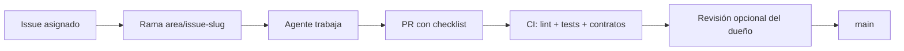

# Colaboración

Varias personas, cada una con sus propios agentes. Este doc define cómo trabajar sin pisarse. Las reglas operativas para agentes están resumidas en [`AGENTS.md`](../AGENTS.md).

## Principios

1. **El estado vive en GitHub, no en archivos.** Tareas = Issues; tablero = GitHub Projects.
2. **Aislamiento**: una rama y un PR por issue. Nadie hace push directo a `main`.
3. **Áreas con dueño humano**: `CODEOWNERS` asigna al dueño como revisor sugerido; la revisión es opcional y no bloquea el merge.
4. **Contratos en código, verificados por CI**: no basta con documentarlos.

## Flujo

1. Toma o crea un issue con etiqueta de área (`area:data`, `area:analysis`, `area:api`, `area:ui`, `area:docs`) y asígnatelo.
2. Rama: `<area>/<n-issue>-<slug>` (ej. `data/12-nasa-power-client`).
3. El PR enlaza el issue (`Closes #12`) y cumple el checklist de la plantilla.
4. Merge: el autor puede hacer merge sin aprobación. Pide revisión si el cambio afecta a otra área.

## Áreas y dueños

| Área | Carpeta | Doc | Dueño |
|---|---|---|---|
| data | `src/data/` | `data-sources.md` | @Alanzphy |
| analysis | `src/analysis/` | `science.md` | @Alanzphy |
| api | `src/api/` | `architecture.md` | @Francisco-Huerta-Trujillo |
| ui | `src/ui/` | `product.md`, `glossary.md` | @Francisco-Huerta-Trujillo |
| contracts | `src/contracts/` | `architecture.md` | ambos |

Cada área tiene su propio `AGENTS.md` con las reglas específicas del área.

## Contratos

- Definidos como esquemas en `src/contracts/` (formato pendiente del ADR de stack); `architecture.md` los describe y enlaza.
- Cambiar un contrato requiere un PR propio con su ADR; avisa a los dueños de las áreas afectadas antes de hacer merge.
- CI valida que productores y consumidores cumplen el esquema.

## Decisiones (ADRs)

- Archivo: `docs/decisions/YYYY-MM-DD-slug.md`. Con fecha en el nombre, dos ramas no pueden generar el mismo número.
- Un ADR aceptado solo se reemplaza con otro ADR que lo referencie.

## Documentación

- Cada PR actualiza los docs de su área en el mismo cambio.
- Los docs compartidos (`architecture.md`, `collaboration.md`) se cambian en PRs pequeños y separados para minimizar conflictos.

## Pendiente de configurar

- [x] Protección de `main`: PR obligatorio, sin aprobaciones requeridas, sin force-push
- [x] Etiquetas `area:*` y `adr`
- [x] `.github/CODEOWNERS`, plantilla de PR y de issue
- [x] Un `AGENTS.md` por área
- [ ] Tablero en GitHub Projects
- [ ] CI requerido en `main` (tras el ADR de stack)
