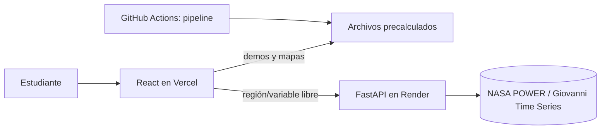

# Stack del proyecto

- **Estado**: aceptado
- **Fecha**: 2026-11-14
- **Autor**: @Alanzphy
- **Issue**: #1

## Contexto

- Lo central del reto es explorar: el estudiante elige una variable y una región y obtiene qué, dónde y cuánto cambia, y si es significativo. Eso exige consultar regiones libres cuando el usuario las pide.
- Los datos de NASA requieren credenciales de Earthdata, que no pueden exponerse en el navegador.
- La evaluación de Space Apps es asíncrona y dura semanas: la portada y las demos deben funcionar siempre.
- Equipo de 2 personas. Presupuesto: $0.

## Decisión

| Capa | Elección | Motivo |
|---|---|---|
| Frontend | **React + Vite + TypeScript** | Flujo guiado con estado; sitio estático |
| Mapa / gráficos | MapLibre GL + Plotly (`react-plotly.js`) | Libre, sin token; series con bandas de IC |
| Backend | **Python 3.12 + FastAPI**, en Docker | Guarda el token; acceso a NASA y estadística nativos de Python |
| Datos en vivo | **Servicios NASA que ya devuelven series promediadas por área**: NASA POWER, Giovanni Time Series | El backend no carga cuadrículas completas: poca RAM, responde en segundos |
| Estadística | pymannkendall, scipy, pandas | Theil–Sen, Mann–Kendall, anomalías |
| Precalculado | Pipeline Python (xarray, earthaccess) en **GitHub Actions** programado | Mapas de tendencia por píxel y demos, servidos como archivos estáticos |
| Contratos | **Pydantic → OpenAPI → tipos TS** (`openapi-typescript`) | Una sola fuente; CI detecta desajustes |
| Base de datos | **Ninguna** | No hay usuarios ni datos que persistir; caché en memoria/disco |
| Gestores / calidad | uv + ruff + pytest; pnpm + eslint + vitest | Estándar en cada ecosistema |
| Hosting | Frontend y archivos precalculados: **Vercel**. Backend: **Render (gratis)** | $0, sin tarjeta, despliegue desde GitHub |

## Flujo

## Alternativas descartadas

| Alternativa | Motivo |
|---|---|
| Solo precalculado, sin backend | Sin regiones libres, que es el núcleo del reto |
| Backend pesado (xarray en cada petición) | Mucha RAM y lentitud; obliga a pagar |
| Streamlit | Flujo guiado y mapa limitados para la audiencia |
| Next.js | El renderizado en servidor no aporta nada; solo agrega complejidad |
| Todo en JavaScript | Reimplementar estadística y acceso a Earthdata, con riesgo de errores |
| Railway, Hugging Face Docker Spaces | Ya no tienen un plan gratuito útil para un servicio encendido |

## Consecuencias

- Render gratis se duerme tras 15 min y tarda ~1 min en despertar. Se mitiga así: portada, demos y mapas no dependen del backend, y la UI muestra un estado de "preparando datos de NASA…". Si hay presupuesto, Render Starter o Cloud Run, sin cambiar el código (Docker).
- El disco de Render se borra al reiniciar: la caché es temporal y eso se acepta.
- **Riesgo a validar primero** (issue de `data`): variables disponibles, tamaño mínimo de región y latencia de NASA POWER y Giovanni Time Series.
- Pendiente: CI (GitHub Actions) con lint, tests y verificación de tipos generados.
